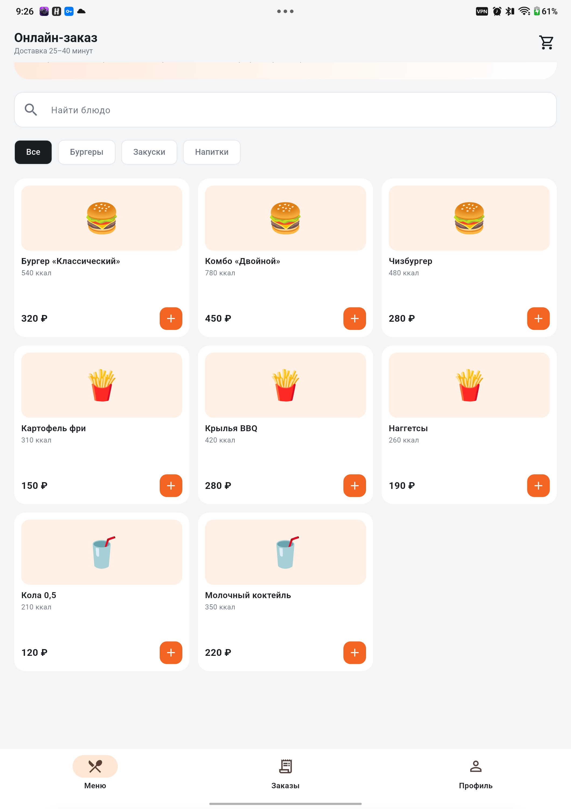
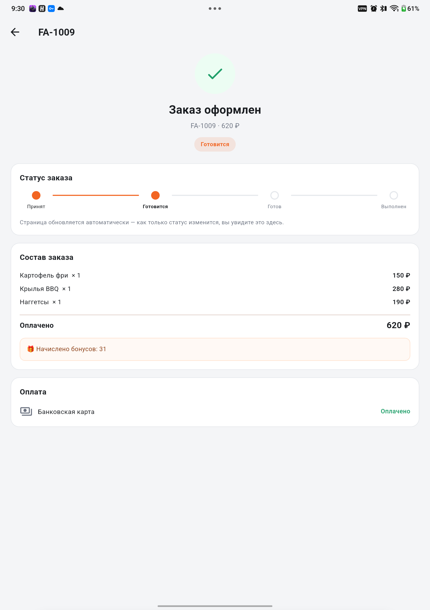

# «Онлайн-заказ» — программный комплекс заказа еды

Учебный проект по ТРПО: единый REST API и три клиента — веб-приложение,
рабочее место оператора (desktop) и мобильное приложение. Реализует
архитектуру из лабораторной №9: клиент-серверная N-Tier система,
модульный монолит, один REST API для всех клиентов, JWT-аутентификация,
real-time через SignalR.

## Состав комплекса

| Компонент | Технологии | Каталог | Назначение |
| --- | --- | --- | --- |
| Backend | ASP.NET Core (.NET 10), EF Core, SQLite/PostgreSQL, JWT, SignalR | `backend/` | единый REST API, бизнес-логика, real-time |
| Web | React 19 + TypeScript + Vite | `web/` | клиентский SPA: меню, корзина, оплата, история |
| Desktop | Electron + TypeScript | `desktop/` | рабочее место оператора: доска заказов, стоп-лист |
| Mobile | Flutter (Dart) → Android | `mobile/` | мобильный клиент: те же сценарии; проверен на планшете Android 16 |
| Infra | Docker Compose, Nginx, PostgreSQL 16, Redis 7 | `infra/` | развёртывание комплекса |
| CI | GitHub Actions | `.github/workflows/ci.yml` | сборка, анализ и smoke-тесты всех компонентов |

```
FastFood projects/
├── backend/                 # ASP.NET Core API + smoke_test.py
├── web/                     # React SPA
├── desktop/                 # Electron-приложение оператора
├── mobile/                  # Flutter-приложение клиента
├── infra/                   # docker-compose, nginx, .env.example
├── docs/screenshots/        # скриншоты работающих клиентов
├── .github/workflows/ci.yml
└── README.md
```

## Быстрый старт (локально)

Требования: .NET SDK 10, Node.js 22+, Python 3 (для smoke-теста).
Flutter нужен только для сборки мобильного приложения.

### 1. Backend

```bash
cd backend/FastFood.Api
dotnet run --urls http://0.0.0.0:5080
```

- API: `http://127.0.0.1:5080/api/v1`
- Swagger UI: `http://127.0.0.1:5080/swagger`
- health-check: `http://127.0.0.1:5080/api/v1/health`
- по умолчанию используется SQLite (`fastfood.db`), БД и демо-данные создаются
  автоматически при старте.

Проверка API:

```bash
cd backend
python3 smoke_test.py
```

Скрипт проходит 23 проверки: вход, каталог, заказ, оплата, бонусы, смена
статуса, стоп-лист, разграничение доступа, SMS-вход, отчёты администратора.

### 2. Web

```bash
cd web
npm install
npm run dev
```

Откройте `http://127.0.0.1:5173`. Адрес API по умолчанию —
`http://127.0.0.1:5080/api/v1`; переопределяется переменной `VITE_API_URL`.

### 3. Desktop (оператор)

```bash
cd desktop
npm install
npm start
```

Откроется рабочее место оператора. Горячие клавиши: `F1` — справка,
`F5` — обновить, `Esc` — закрыть справку.

### 4. Mobile

```bash
cd mobile
flutter create --platforms=android .
flutter pub get
flutter run --dart-define=API_BASE=http://10.0.2.2:5080/api/v1
```

Подробности (разрешения Android, адрес для планшета, сборка APK) —
в `mobile/README.md`.

## Демо-доступ

| Роль | Телефон | Пароль | Где используется |
| --- | --- | --- | --- |
| Клиент | `+79991234567` | `12345` | web, mobile |
| Оператор | `+79990000001` | `12345` | desktop |
| Администратор | `+79990000002` | `12345` | API/Swagger |

SMS-вход в демо-режиме: код `0000`.

## Скриншоты

| Web — меню | Web — оформление |
| --- | --- |
|  |  |

| Desktop — доска заказов | Desktop — стоп-лист |
| --- | --- |
|  |  |

| Web — статус заказа | Мобильная вёрстка web |
| --- | --- |
|  |  |

| Mobile — меню (планшет) | Mobile — статус заказа |
| --- | --- |
|  |  |

## REST API

Базовый префикс — `/api/v1`, формат — JSON. Защищённые методы требуют
заголовок `Authorization: Bearer <accessToken>`.

| Метод | Путь | Доступ | Назначение |
| --- | --- | --- | --- |
| GET | `/health` | все | проверка живости |
| POST | `/auth/login` | все | вход по телефону и паролю |
| POST | `/auth/sms-code` | все | запрос SMS-кода (демо) |
| POST | `/auth/login-sms` | все | вход по коду |
| POST | `/auth/refresh` | все | обновление JWT |
| GET | `/menu-items` | все | каталог (стоп-лист скрыт) |
| GET | `/menu-items/{id}` | все | карточка блюда |
| GET | `/categories` | все | список категорий |
| PATCH | `/menu-items/{id}/stoplist` | Staff | стоп-лист |
| POST | `/orders` | Customer | создание заказа |
| GET | `/orders` | все | список (клиент — только свои) |
| GET | `/orders/{id}` | все | детали заказа |
| PATCH | `/orders/{id}/status` | Staff | смена статуса |
| POST | `/payments` | Customer | оплата и начисление бонусов |
| GET | `/payments/{id}` | все | статус платежа |
| GET | `/loyalty/balance` | Customer | бонусный баланс |
| POST | `/loyalty/spend` | Customer | списание бонусов |
| GET | `/users/me` | авторизованные | профиль |
| PATCH | `/users/me` | авторизованные | изменение имени |
| GET | `/users/me/orders` | Customer | история заказов |
| POST | `/admin/promotions` | Admin | создание акции |
| GET | `/admin/promotions` | Admin | список акций |
| GET | `/admin/reports/sales` | Admin | отчёт по продажам |

Real-time хаб: `/hubs/orders`, события `OrderCreated`, `OrderStatusChanged`,
`StopListChanged`. Клиент-оператор вызывает `JoinOperators`, клиент заказа —
`JoinOrder(orderNumber)`.

## Развёртывание (Docker)

```bash
cd infra
cp .env.example .env      # задайте свои POSTGRES_PASSWORD и JWT_KEY
docker compose up --build
```

- приложение: `http://localhost:8080`
- API через Nginx: `http://localhost:8080/api/v1/health`
- Swagger: `http://localhost:8080/swagger`

В production-профиле API работает с PostgreSQL 16; Redis предусмотрен для
кэша и фоновых задач. Схема БД создаётся автоматически при первом старте.

## CI/CD

`.github/workflows/ci.yml` содержит четыре независимые задачи:

1. **Backend** — сборка .NET, запуск API и smoke-тест (`smoke_test.py`);
2. **Web** — `npm ci` и production-сборка SPA;
3. **Desktop** — проверка типов TypeScript и сборка Electron-приложения;
4. **Mobile** — генерация Android-обвязки, `flutter analyze`, `flutter test` и debug APK.

## Соответствие архитектуре из ЛР9

- **Клиент-серверная архитектура**: все клиенты работают только через REST API,
  бизнес-логика и данные сосредоточены на сервере.
- **N-Tier / слои**: `Endpoints` (API), `Services` (токены), `Data` (EF Core),
  `Models` (домен), `Hubs` (real-time).
- **Модульный монолит**: единый процесс API с выделенными модулями
  (аутентификация, каталог, заказы, платежи, лояльность, администрирование).
- **Единый контракт**: DTO и коды ошибок одинаковы для web, desktop и mobile.
- **Безопасность**: JWT (access + refresh), роли Customer / Operator / Admin,
  проверка владельца заказа, ограничение прав на стоп-лист и отчёты.
- **Real-time**: SignalR-группы операторов и конкретного заказа.
