# «Онлайн-заказ» — программный комплекс заказа еды

Учебный проект по ТРПО: единый REST API и три клиента — веб-приложение,
рабочее место оператора (desktop) и мобильное приложение. Реализует
архитектуру из лабораторной №9: клиент-серверная N-Tier система,
модульный монолит, один REST API для всех клиентов, JWT-аутентификация,
real-time через SignalR.

## Состав комплекса

| Компонент | Технологии | Каталог | Назначение |
| --- | --- | --- | --- |
| Backend | ASP.NET Core (.NET 10), EF Core, SQLite/PostgreSQL, JWT, SignalR | `backend/` | единый REST API, бизнес-логика, real-time |
| Web | React 19 + TypeScript + Vite | `web/` | клиентский SPA: меню, корзина, оплата, история |
| Desktop | Electron + TypeScript | `desktop/` | рабочее место оператора и менеджера: доска заказов, стоп-лист, отчёты, журнал действий, акции, сотрудники |
| Mobile | Flutter (Dart) → Android | `mobile/` | мобильный клиент: те же сценарии; проверен на Google Pixel 7 (Android 16) |
| Infra | Tuna + Vite preview (демо); Docker Compose/Nginx/PostgreSQL — опционально | `infra/` | публикация без белого IP; production-профиль |
| CI | GitHub Actions | `.github/workflows/ci.yml` | сборка, анализ и smoke-тесты всех компонентов |

```
FastFood projects/
├── backend/                 # ASP.NET Core API + smoke_test.py
├── web/                     # React SPA
├── desktop/                 # Electron: оператор и менеджер
├── mobile/                  # Flutter-приложение клиента
├── infra/                   # опционально: docker-compose, nginx, PostgreSQL
├── docs/screenshots/        # скриншоты работающих клиентов
├── scripts/                 # start-public.sh / stop-public.sh (Tuna)
├── .github/workflows/ci.yml
└── README.md
```

## Быстрый старт (локально)

Требования: .NET SDK 10, Node.js 22+, Python 3 (для smoke-теста).
Flutter нужен только для сборки мобильного приложения.

### 1. Backend

```bash
cd backend/FastFood.Api
dotnet run --urls http://0.0.0.0:5080
```

- API: `http://127.0.0.1:5080/api/v1`
- Swagger UI: `http://127.0.0.1:5080/swagger`
- health-check: `http://127.0.0.1:5080/api/v1/health`
- по умолчанию используется SQLite (`fastfood.db`), БД и демо-данные создаются
  автоматически при старте.

Проверка API:

```bash
cd backend
python3 smoke_test.py
```

Скрипт проходит 36+ проверок: вход, каталог, заказ, оплата, бонусы, смена
статуса, стоп-лист, разграничение доступа, SMS-вход, отчёты администратора,
создание/блокировка сотрудника, изменение акции и аудит отмены.

### 2. Web

```bash
cd web
npm install
npm run dev
```

Откройте `http://127.0.0.1:5173`. Адрес API по умолчанию —
`http://127.0.0.1:5080/api/v1`; переопределяется переменной `VITE_API_URL`.

### 3. Desktop (оператор и менеджер)

```bash
cd desktop
npm install
npm start
```

Откроется рабочее место оператора; для менеджера доступна вкладка
**«Управление»**. Горячие клавиши: `F1` — справка, `F5` — обновить,
`Esc` — закрыть диалог.

### 4. Mobile

```bash
cd mobile
flutter create --platforms=android .
flutter pub get
flutter run --dart-define=API_BASE=http://10.0.2.2:5080/api/v1
```

Подробности (разрешения Android, адрес для телефона/планшета, сборка APK) —
в `mobile/README.md`.

### 5. Публичный доступ без белого IP

Для демонстрации используется постоянный HTTPS-туннель **Tuna** (российский
сервис, данные не уходят в зарубежный облачный прокси). Один туннель отдаёт
и web, и API: Vite preview проксирует `/api`, `/hubs` и `/swagger` на
локальный Kestrel.

- Web: `https://lucky-crane-4648.a.tuna.free`
- API: `https://lucky-crane-4648.a.tuna.free/api/v1`
- Swagger: `https://lucky-crane-4648.a.tuna.free/swagger`
- health-check: `https://lucky-crane-4648.a.tuna.free/api/v1/health`

Запуск всего комплекса одной командой:

```bash
cd "FastFood projects"
./scripts/start-public.sh
```

Остановка:

```bash
./scripts/stop-public.sh
```

Скрипт поднимает API на `5080`, web preview на `8080` и туннель
`tuna http 8080 --subdomain=lucky-crane-4648`. Tuna CLI должен быть
установлен и авторизован (`tuna login`); инструкция — в
`scripts/start-public.sh`.

При первом открытии web в браузере бесплатный Tuna показывает страницу
подтверждения — нажмите **«Посетить»**. Мобильное приложение это
предупреждение не показывает. Для production нужен собственный домен/VPS
или платный тариф без предупреждения.

## Готовые релизы

Артефакты для Windows, Linux и Android прикладываются к GitHub Releases.
Состав, инструкции по запуску и команды сборки — в [RELEASES.md](RELEASES.md).

```bash
./scripts/build-releases.sh   # собрать переносимые версии desktop и подготовить APK
```

## Демо-доступ

| Роль | Телефон | Пароль | Где используется |
| --- | --- | --- | --- |
| Клиент | `+79991234567` | `12345` | web, mobile |
| Оператор | `+79990000001` | `12345` | desktop |
| Администратор (менеджер) | `+79990000002` | `12345` | desktop, Swagger |

SMS-вход в демо-режиме: код `0000`.

## Роль менеджера

Менеджер — не «второй оператор»: в desktop-приложении ему доступна отдельная
вкладка **«Управление»**.

- **Отчёты и выручка** — оплаченные заказы, средний чек, выполненные и
  отменённые заказы, топ блюд за 30 дней.
- **Журнал действий** — кто и когда принял, приготовил, выдал или отменил
  заказ; в журнале видны ID, ФИО и роль сотрудника, а также причина отмены.
- **Сотрудники** — список с ID, ФИО, телефоном и статусом доступа; можно
  добавить оператора или менеджера и заблокировать/разблокировать доступ.
  Физического удаления нет: учётная запись остаётся в истории, но не может
  войти в систему.
- **Акции** — создание, изменение названия/скидки, привязка ко всем блюдам,
  категории или конкретному блюду, включение/выключение без удаления записи.
  Для привязанной акции сервер сам уменьшает цену в меню и при создании
  заказа, поэтому скидка действует одинаково во всех клиентах.

Заблокированный сотрудник теряет доступ сразу, даже если его JWT ещё не
истёк: сервер проверяет признак `IsActive` при каждом запросе.

## Скриншоты

| Web — меню | Web — оформление |
| --- | --- |
| 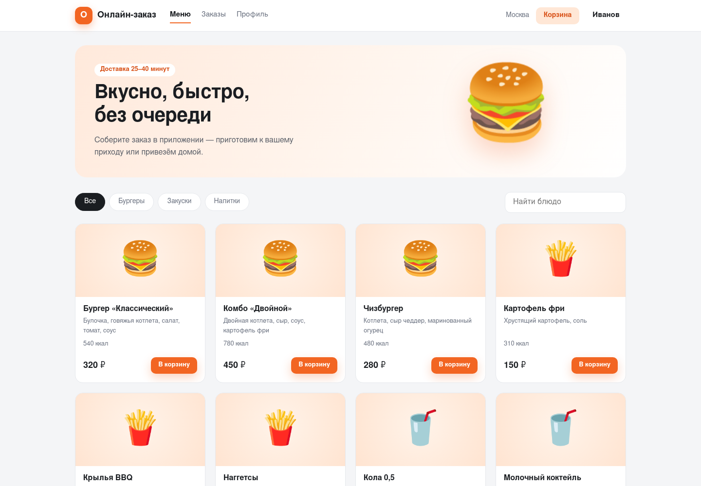 | 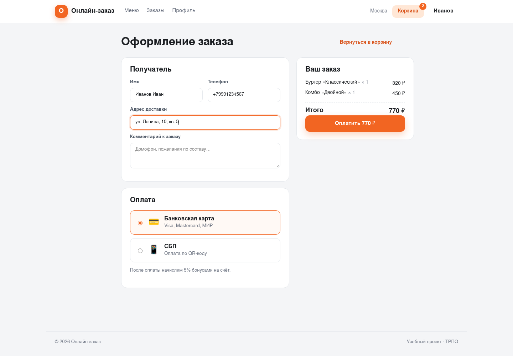 |

| Desktop — доска заказов | Desktop — стоп-лист |
| --- | --- |
| 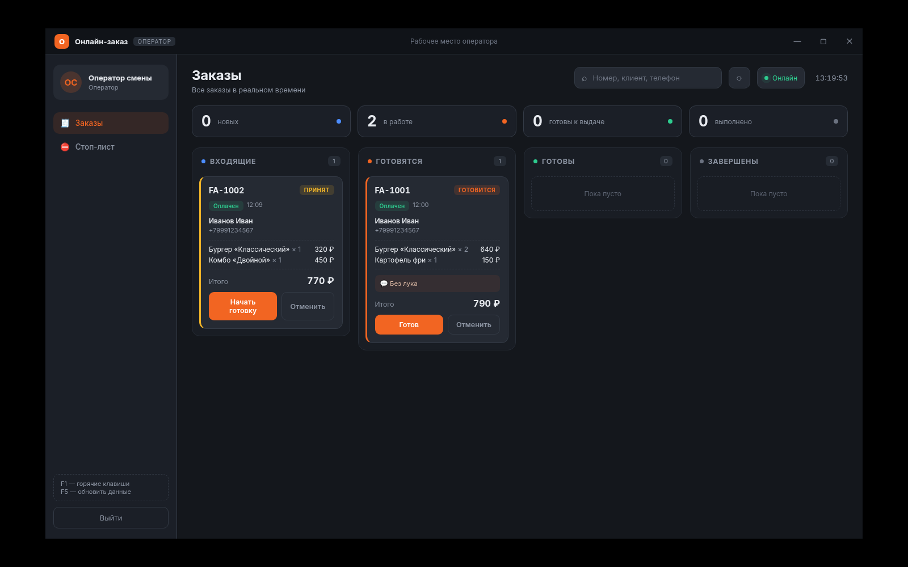 | 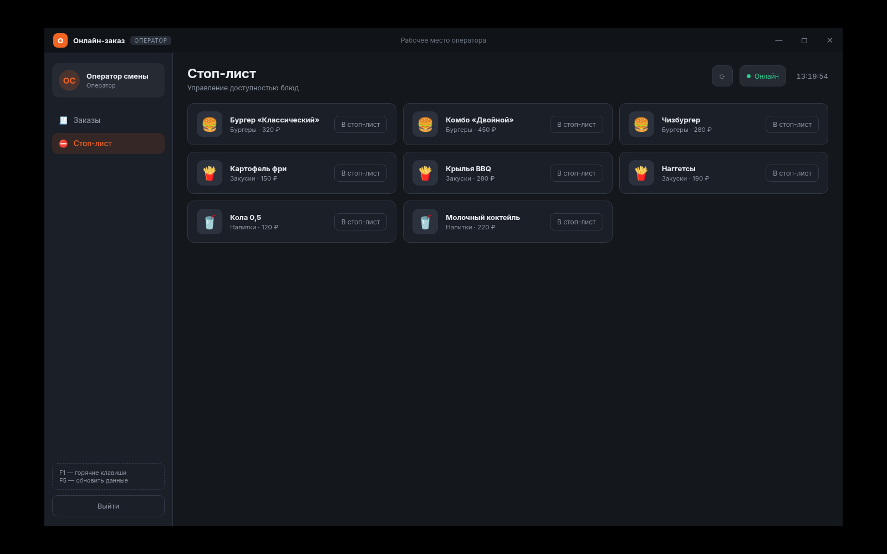 |

| Desktop — отчёты и журнал менеджера | Desktop — сотрудники и акции |
| --- | --- |
| 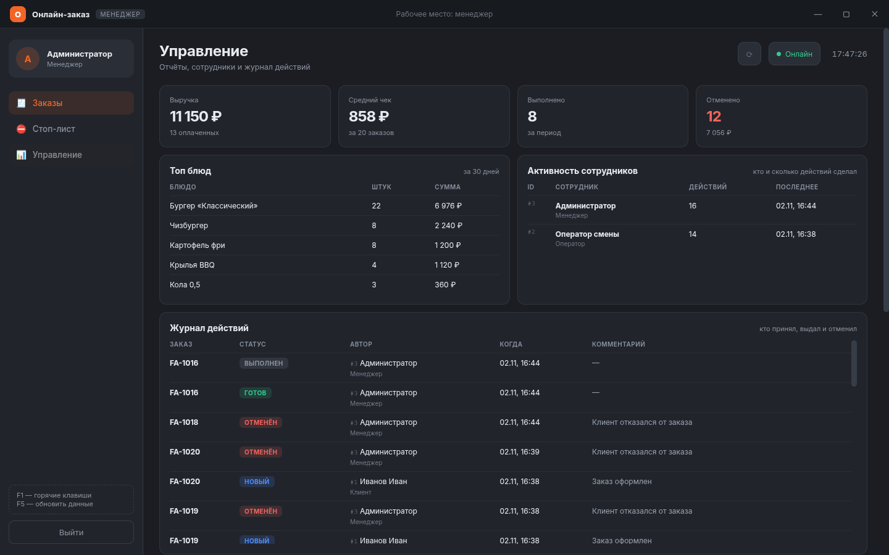 | 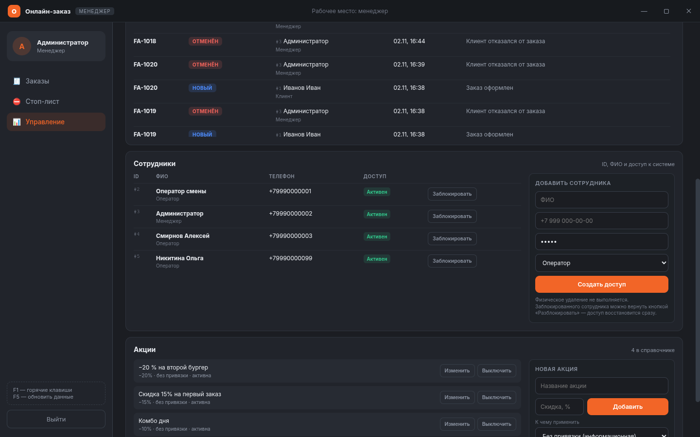 |

| Swagger UI | Web — статус заказа |
| --- | --- |
| 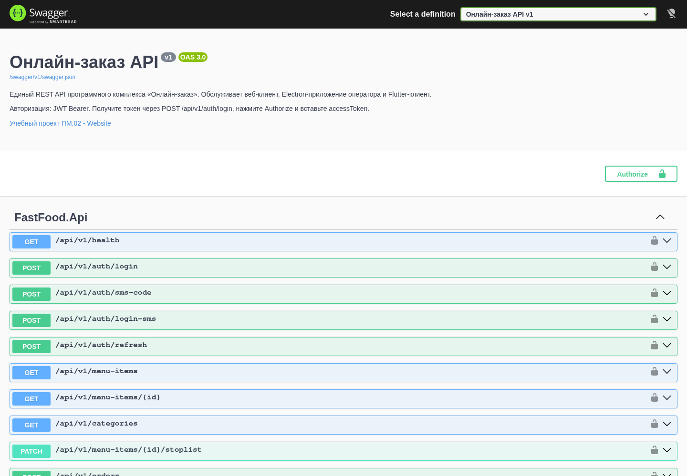 | 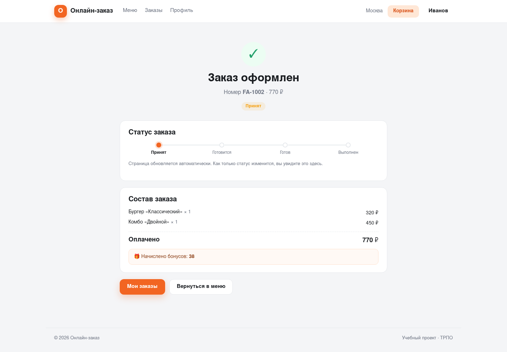 |

| Мобильная вёрстка web | Mobile — меню (Pixel 7) |
| --- | --- |
| 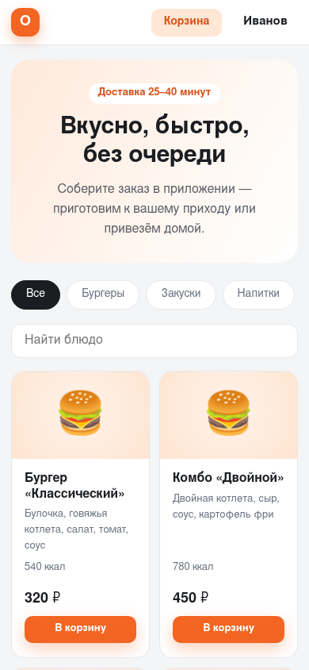 | 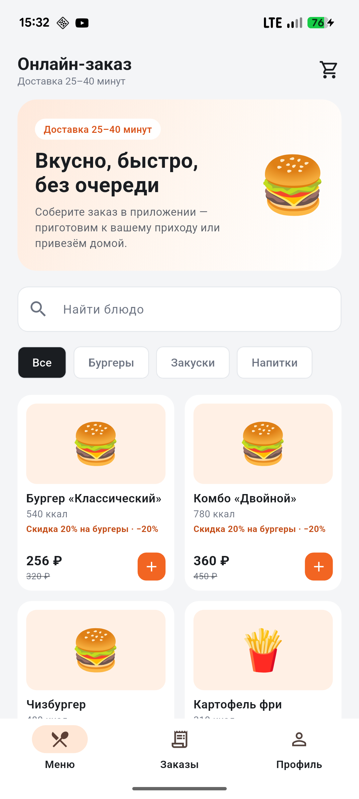 |

| Mobile — корзина (Pixel 7) | Mobile — оформление (Pixel 7) |
| --- | --- |
| 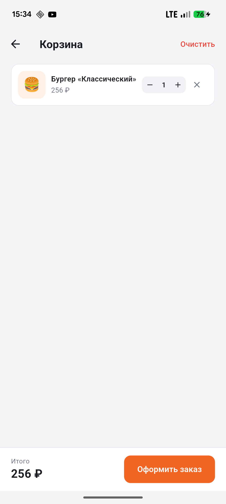 | 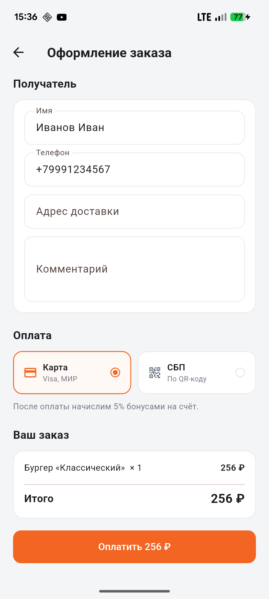 |

| Mobile — заказ оформлен (Pixel 7) | Mobile — статус обновился (Pixel 7) |
| --- | --- |
| 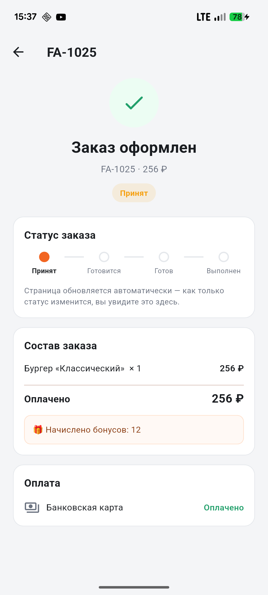 | 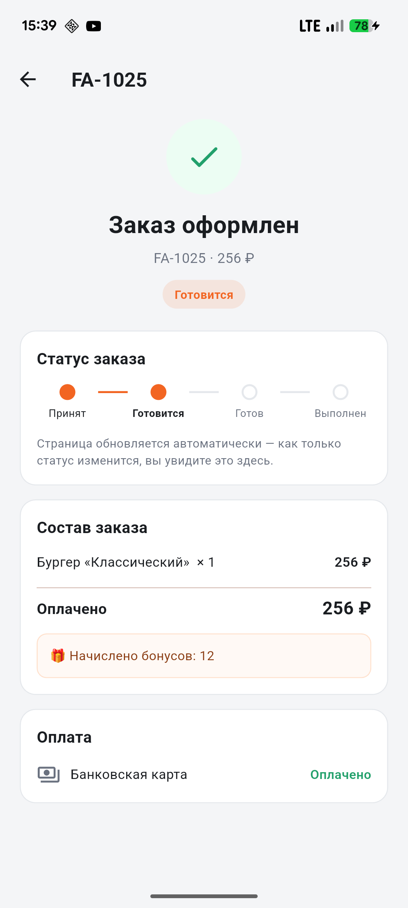 |

Старые скриншоты планшета остаются в `docs/screenshots/mobile-tablet-*.png`
как история проверки на Android-планшете.

## REST API


Базовый префикс — `/api/v1`, формат — JSON. Защищённые методы требуют
заголовок `Authorization: Bearer <accessToken>`.

Все три клиента работают с одним контрактом: web, desktop и mobile не имеют
собственных «серверных» копий данных. Контракт описан в Swagger
(`/swagger`) и в JSON-схеме OpenAPI.

**Авторизация в Swagger:**

1. Выполните `POST /api/v1/auth/login` с телефоном и паролем демо-пользователя.
2. Скопируйте `accessToken` из ответа.
3. Нажмите **Authorize**, вставьте токен и подтвердите.
4. Закрытые методы станут доступны с учётом роли (`Operator`/`Administrator`).

```bash
curl -X POST http://127.0.0.1:5080/api/v1/auth/login \
  -H "Content-Type: application/json" \
  -d '{"phone":"+79990000002","password":"12345"}'
```

| Метод | Путь | Доступ | Назначение |
| --- | --- | --- | --- |
| GET | `/health` | все | проверка живости |
| POST | `/auth/login` | все | вход по телефону и паролю |
| POST | `/auth/sms-code` | все | запрос SMS-кода (демо) |
| POST | `/auth/login-sms` | все | вход по коду |
| POST | `/auth/refresh` | все | обновление JWT |
| GET | `/menu-items` | все | каталог (стоп-лист скрыт) |
| GET | `/menu-items/{id}` | все | карточка блюда |
| GET | `/categories` | все | список категорий |
| PATCH | `/menu-items/{id}/stoplist` | Staff | стоп-лист |
| POST | `/orders` | Customer | создание заказа |
| GET | `/orders` | все | список (клиент — только свои) |
| GET | `/orders/{id}` | все | детали заказа |
| PATCH | `/orders/{id}/status` | Staff | смена статуса |
| POST | `/payments` | Customer | оплата и начисление бонусов |
| GET | `/payments/{id}` | все | статус платежа |
| GET | `/loyalty/balance` | Customer | бонусный баланс |
| POST | `/loyalty/spend` | Customer | списание бонусов |
| GET | `/users/me` | авторизованные | профиль |
| PATCH | `/users/me` | авторизованные | изменение имени |
| GET | `/users/me/orders` | Customer | история заказов |
| POST | `/admin/promotions` | Administrator | создание акции |
| GET | `/admin/promotions` | Administrator | список акций |
| PATCH | `/admin/promotions/{id}` | Administrator | изменение/выключение акции |
| GET | `/admin/staff` | Administrator | список сотрудников и их доступ |
| POST | `/admin/staff` | Administrator | создание оператора/менеджера |
| PATCH | `/admin/staff/{id}/active` | Administrator | блокировка/разблокировка |
| GET | `/admin/reports/sales` | Administrator | выручка, средний чек, топ блюд, активность сотрудников |

Каждый заказ содержит массив `statusHistory`: статус, время, автор (ID, ФИО,
роль) и комментарий/причина отмены. На его основе менеджер видит, кто принял,
выдал или отменил заказ. Отмена доступна оператору и менеджеру; физического
удаления заказов нет — сохраняется полный аудит.

Real-time хаб: `/hubs/orders`, события `OrderCreated`, `OrderStatusChanged`,
`StopListChanged`. Клиент-оператор вызывает `JoinOperators`, клиент заказа —
`JoinOrder(orderNumber)`.

При блокировке сотрудника сервер отклоняет его действующий JWT с кодом `401`,
поэтому доступ прекращается сразу, а не через 15 минут.

## Развёртывание (Docker, опционально)

```bash
# В демонстрационном контуре Docker не используется.
# Команды ниже — для production-профиля.
cd infra
cp .env.example .env      # задайте свои POSTGRES_PASSWORD и JWT_KEY
docker compose up --build
```

- приложение: `http://localhost:8080`
- API через Nginx: `http://localhost:8080/api/v1/health`
- Swagger: `http://localhost:8080/swagger`

В демонстрационном контуре используется SQLite; Docker, Nginx, PostgreSQL и Redis не запускаются. В production-профиле API работает с PostgreSQL 16; Redis предусмотрен как опция для кэша и фоновых задач. Схема БД создаётся автоматически при первом старте.

## CI/CD

`.github/workflows/ci.yml` содержит четыре независимые задачи:

1. **Backend** — сборка .NET, запуск API и smoke-тест (`smoke_test.py`);
2. **Web** — `npm ci` и production-сборка SPA;
3. **Desktop** — проверка типов TypeScript и сборка Electron-приложения;
4. **Mobile** — генерация Android-обвязки, `flutter analyze`, `flutter test` и debug APK.

## Соответствие архитектуре из ЛР9

- **Клиент-серверная архитектура**: все клиенты работают только через REST API,
  бизнес-логика и данные сосредоточены на сервере.
- **N-Tier / слои**: `Endpoints` (API), `Services` (токены), `Data` (EF Core),
  `Models` (домен), `Hubs` (real-time).
- **Модульный монолит**: единый процесс API с выделенными модулями
  (аутентификация, каталог, заказы, платежи, лояльность, администрирование).
- **Единый контракт**: DTO и коды ошибок одинаковы для web, desktop и mobile.
- **Безопасность**: JWT (access + refresh), роли Customer / Operator /
  Administrator, проверка владельца заказа, ограничение прав на стоп-лист,
  акции, сотрудников и отчёты; аудит действий и блокировка без удаления.
- **Real-time**: SignalR-группы операторов и конкретного заказа.
